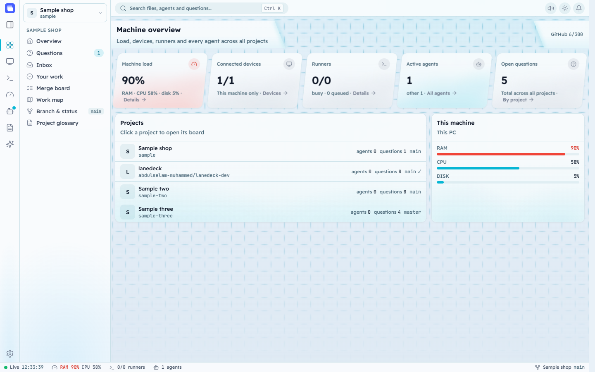
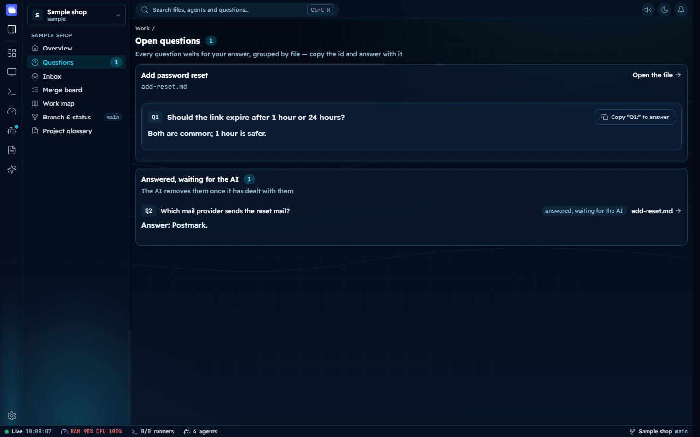
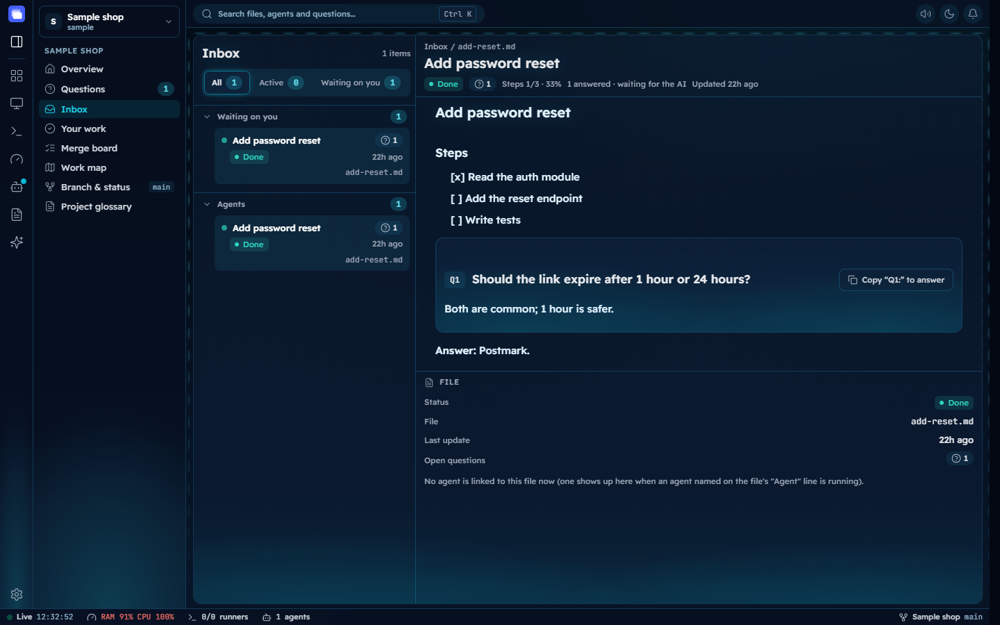
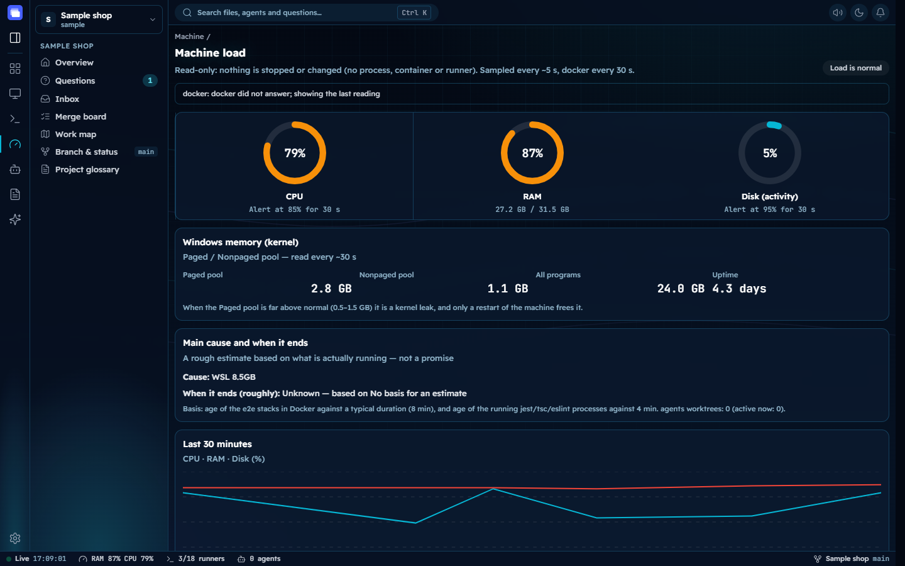

# lanedeck

A local control room for working with AI coding agents: CI runners, machine load, Claude Code agents, GitHub PRs and a per-project work map, in one dashboard.


## Features

**Machine level** (everything on this computer and the machines next to it)

- **Overview**: load, devices, runners, active agents and open questions across all projects at a glance.
- **Machine load**: CPU, RAM and disk with alert thresholds, the main cause of a high load and a rough "when it ends" estimate. Windows adds kernel pools and per-process groups.
- **CI runners**: your org's self-hosted GitHub Actions runners (docker, local or over SSH), their jobs and the queue. Read-only: nothing is stopped or changed.
- **Agents**: every Claude Code agent and subagent that is running or just finished, with its state and progress.
- **Devices**: this machine as detected, plus SSH machines you add, with a connection test.
- **Skills**: how to install the Claude Code plugin and what each skill does.
- **Settings**: language, direction, projects, monitoring thresholds, the remote access token.

**Project level** (one section per project you add)

- **Overview**: what the project is, active agents, inbox activity, open questions, the PR and branch state.
- **Questions and Inbox**: the tasks your AI writes (`.lanedeck/inbox/`), their steps and the questions waiting for your answer.
- **Merge board**: every open PR, live: where it stands, who it waits for, what failed, what merged, and conflicts down to the hunk.
- **Work map**: what is done, in progress, waiting and next, drawn from `.lanedeck/map.md`.
- **Branch and status**: whether your local clone is behind the default branch on GitHub.
- **Project glossary**: the terms of the project, next to a built-in general glossary (English or Arabic).

More views are in [Screenshots](#screenshots).

## Install

Requirements:

- Node 20 or newer
- `git`
- the [GitHub CLI](https://cli.github.com/) (`gh`), logged in (`gh auth login`): the PR board and runners read GitHub through it
- optional: WSL with docker (Windows) or a native `docker` (Linux/macOS) for the local CI runners panel; `ssh` for remote machines

Run it without installing, or install it once:

```bash
npx lanedeck
# or
npm i -g lanedeck
lanedeck
```

Open <http://127.0.0.1:4280>. Options: `--port <n>`, `--host <addr>` (a non-loopback host needs `server.accessToken` in the config), `--help`. The environment variables `PORT`, `LANEDECK_HOST` and `LANEDECK_CONFIG` work too.

### From source

```bash
git clone https://github.com/abdulselam-muhammed/lanedeck.git
cd lanedeck
npm ci
npm run build
npm start
```

Open <http://127.0.0.1:4280>. `npm run dev` runs a development server instead.

The deck starts with defaults and no project. Open Settings, then Projects, then Add project, pick a local folder and it fills in the repo, branch and CI checks.

## Configuration

One JSON file, deep-merged over generic built-in defaults:

| OS | Default path |
|---|---|
| Windows | `%APPDATA%\lanedeck\config.json` |
| Linux | `$XDG_CONFIG_HOME/lanedeck/config.json` or `~/.config/lanedeck/config.json` |
| macOS | `~/.config/lanedeck/config.json` |

Set `LANEDECK_CONFIG` to use another file (it must exist). Copy [`config.example.json`](https://github.com/abdulselam-muhammed/lanedeck/blob/main/config.example.json) to the path above and edit it, or use the **Settings** page, which edits the same file (atomically, keeping the last 20 backups). A bad value stops the server with a message naming the key.

| Key | Meaning |
|---|---|
| `server` | `port` (the `PORT` env var wins), `host` (default `127.0.0.1`), `allowedHosts`, `accessToken`, `allowUnauthenticatedRemote` |
| `tools` | `gh` and `git` paths; `null` = found on `PATH` |
| `machine` | `wslDistro`, `ciContainer`, `runnerImage` / `runnerName` / `teamName` (regex sources), `localLabel`, `thresholds`, `remoteThresholds`, `machines` (`[{ id, label, sshAlias }]`) |
| `github` | `org` (for the runners and jobs page), `rateBudgetPerHour` |
| `projects[]` | `id`, `name`, `repoPath`, `repo` (`owner/name`), `defaultBranch`, `gateCheck`, `inboxDir`, `claudeProjectDir`, `me`, `reviewers[]`, `boardFiles`, `reviewMarkers`, `holds`, `profile` |
| `ui` | `lang` (`en` or `ar`), `dir` (`ltr` or `rtl`), `title`, `brand`, `runnerPrefix` |

Environment overrides: `PORT`, `INBOX_DIR`, `CLAUDE_PROJECT_DIR`.

**Profiles.** A project may name a `profile`: a folder `<config folder>/profiles/<name>/profile.json` (next to `config.json`, or next to the default config file when `LANEDECK_CONFIG` points elsewhere) with project-specific wording and a glossary. Without one the deck uses neutral text.

## Projects and the `.lanedeck` protocol

lanedeck follows the work of each project through a small folder of plain Markdown, `.lanedeck/`, in the project:

```
.lanedeck/
  project.md    what the project is
  map.md        the work map: done, now, waiting, next
  glossary.md   terms of this project
  inbox/        git-ignored; one task file per task, with steps and questions
```

The human and the AI write these files; the dashboard reads them and, only after you confirm, writes the setup files (`PROTOCOL.md`, `inbox/00-setup.md`, a line in `.gitignore`, and an optional block in `AGENTS.md` or `CLAUDE.md`). The full contract is in [docs/PROTOCOL.md](https://github.com/abdulselam-muhammed/lanedeck/blob/main/docs/PROTOCOL.md).

## Use with your AI

- **Claude Code**: install the plugin once, then run `/lanedeck:init` in a project.

  ```
  /plugin marketplace add abdulselam-muhammed/lanedeck
  /plugin install lanedeck@lanedeck
  ```

  To try it without installing: `claude --plugin-dir ./plugin`. Details in [plugin/README.md](https://github.com/abdulselam-muhammed/lanedeck/blob/main/plugin/README.md).
- **Any other AI** (Cursor, Codex, Gemini and so on): they cannot use the plugin. Open the project's setup task in the Inbox and press "Copy prompt (any AI)", then paste it into your AI. To make every session follow the protocol, press "Add lanedeck instructions to AGENTS.md / CLAUDE.md", which adds one marked block ([templates/AGENTS-block.md](https://github.com/abdulselam-muhammed/lanedeck/blob/main/templates/AGENTS-block.md)). Nothing is written into a project before you confirm.

## Security model

- **Local only by default.** The server binds `127.0.0.1`. Every request (pages, assets, API, SSE, WebSocket) passes one guard first: the `Host` must be loopback with the port or one of `server.allowedHosts`, and a foreign `Origin` or cross-site `/api` request is refused with 403.
- **Remote access needs a token.** A request that does not come straight from this machine (a tunnel host, a proxy header, a non-loopback client) must carry the `sd_access` cookie, got by opening the deck once with `?token=<token>`, or an `Authorization: Bearer` header. The cookie is HttpOnly and SameSite=Strict. With `allowedHosts` set and no token the deck refuses to start. Create and rotate the token in Settings. Put a login in front of any tunnel as the outer layer; a token holder can read everything the deck shows.
- **Settings and setup are local-only** and need a same-origin request plus a CSRF token.
- **Project folders are untrusted.** The protocol reader and the setup dialog never follow a symlink or junction, and nothing is written outside the real project path.
- **What never leaves the machine.** There is no telemetry and no cloud service. The deck talks to GitHub only through your own `gh` login, within a configurable request budget, and to machines you list over your own SSH. The browser gets only the harmless part of the config; paths, hosts and tool locations stay on the server.

## Platform support

| Feature | Windows + WSL | Linux / macOS |
|---|---|---|
| Server, inbox, PR board, branch check, settings | yes | yes |
| Machine load: CPU / RAM / disk | yes (PowerShell sampler) | yes (Node `os` + `df`) |
| Per-process groups, kernel pools | yes | not yet |
| CI runners, this machine | yes (docker inside WSL) | yes with a native `docker` on `PATH` |
| CI runners, remote machines (ssh) | yes | yes |

A missing tool (`powershell.exe`, `wsl.exe`, `docker`, `ssh`) switches that one feature off with a message on the page; it never stops the server. Linux and macOS are covered by tests that force the platform (`LANEDECK_PLATFORM=linux`), not yet by real machines.

## Screenshots

| | |
|---|---|
|  |  |
|  |  |
|  |  |
|  |  |
|  |  |

## Roadmap

- `npx lanedeck` packaging
- Enabling a CI runner from a device card
- Real-machine testing on Linux and macOS, per-process load groups there
- More languages for the interface

## Contributing

Issues and pull requests are welcome. Before sending a change run `npm run typecheck`, `npm run lint`, `npm test` and `npm run check` (i18n and protocol checks). Every user-facing string goes through the dictionary in `server/i18n/areas/`, in English and Arabic. See [ARCHITECTURE.md](https://github.com/abdulselam-muhammed/lanedeck/blob/main/ARCHITECTURE.md) for how the code is laid out.

## License

MIT, see [LICENSE](https://github.com/abdulselam-muhammed/lanedeck/blob/main/LICENSE). Third-party notices: [THIRD_PARTY_NOTICES.md](https://github.com/abdulselam-muhammed/lanedeck/blob/main/THIRD_PARTY_NOTICES.md).
